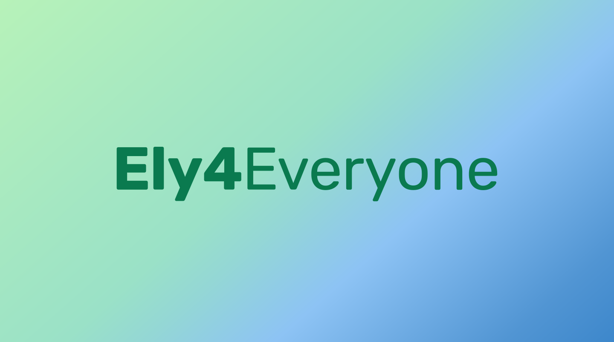
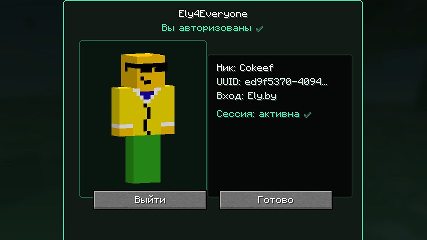
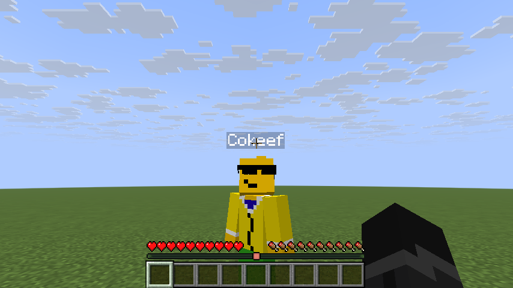

<p align="center">
  
</p>

<p align="center">
  <a href="https://modrinth.com/mod/ely4everyone"></a>
  
  
  <a href="https://github.com/HorniCompany/Ely4Everyone/actions/workflows/ci.yml"></a>
  <a href="LICENSE"></a>
</p>

<p align="center">
  <b>Log in with Ely.by right inside the game. No authlib-injector, no special launcher.</b><br>
  🇷🇺 <a href="README.md">Читать на русском</a>
</p>

> [!WARNING]
> **The code of this mod is written by AI** (Claude), directed by a human who sets the tasks and tests the results.
> The mod is in **alpha**: expect bugs, and try it yourself before using it on a public server.

## ✨ Features

- 🔑 **Ely.by login from the game menu.** A button on the title screen opens the Ely.by page in your browser, you confirm, done. Works in any launcher: Modrinth App, Prism, the official one.
- 🧍 **Your Ely.by skin** in singleplayer and on servers, with a preview in the menu.
- 👥 **Other players' Ely.by skins** by nickname on any server. Players without an Ely.by skin keep their usual one.
- 🌐 **Join servers with Ely.by authentication** using your Ely.by account.
- 🔒 **Your login stays out of modpacks.** Tokens live in the system password store (Windows) or in a private file in your user folder, never in `config/`. Exporting a modpack can't leak them, and one login works in every instance.
- 🔄 **The session renews itself**, no need to log in again every day.
- 🌍 **English and Russian**, following the game language.

## 📸 Screenshots

<p align="center">
  
  
</p>

## 📦 Installation

1. Install [Fabric Loader](https://fabricmc.net/use/) and [Fabric API](https://modrinth.com/mod/fabric-api).
2. Download Ely4Everyone for your game version from [Modrinth](https://modrinth.com/mod/ely4everyone) or the [releases](https://github.com/HorniCompany/Ely4Everyone/releases):

   | Minecraft | File | Java |
   |---|---|---|
   | 26.3 | `ely4everyone-mod-…+26.3.jar` | 25 |
   | 26.2 | `ely4everyone-mod-…+26.2.jar` | 25 |
   | 26.1.2 | `ely4everyone-mod-…+26.1.2.jar` | 25 |
   | 1.21.11 | `ely4everyone-mod-…+1.21.11.jar` | 21 |

3. Put the jar into your `mods` folder and start the game.
4. On the title screen press the **E** button left of "Options", then "Log in with Ely.by" and confirm on the Ely.by page that opens.

The "Log out" button on the same screen switches the game back to your usual account. The mod speaks English, and Russian when the game is set to Russian.

## 🛠️ How it works

- The login goes **straight to Ely.by** over OAuth (device code), no servers in between.
- The mod hooks into the game with **Mixin**: the active account, joining servers and skin loading. No javaagents, no runtime JVM patching.
- One code base for every version, thanks to [Stonecutter](https://stonecutter.kikugie.dev/).

## 🖥️ For server owners

The mod is client-side only, servers don't need it. To let players with Ely.by accounts in, the server has to verify them through Ely.by, for example with [authlib-injector](https://docs.ely.by/en/authlib-injector.html) pointed at Ely.by.

## 🧑‍💻 Building

```bash
./gradlew build
```

Gradle downloads the JDKs it needs (21 and 25) by itself. The jars end up in `mod/versions/<version>/build/libs/`.

## 📄 License

[MIT](LICENSE). Not affiliated with Ely.by.
