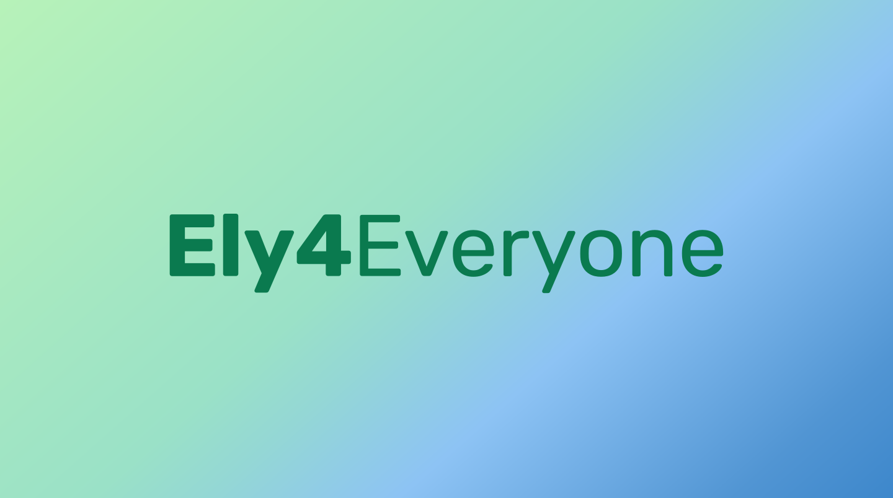
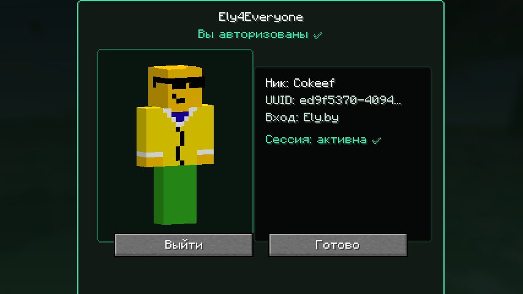
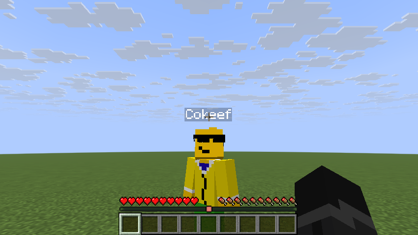

<p align="center">
  
</p>

<p align="center">
  <a href="https://modrinth.com/mod/ely4everyone"></a>
  
  
  <a href="https://github.com/HorniCompany/Ely4Everyone/actions/workflows/ci.yml"></a>
  <a href="LICENSE"></a>
</p>

<p align="center">
  <b>Вход через Ely.by прямо в игре. Без authlib-injector и особых лаунчеров.</b><br>
  🇬🇧 <a href="README.en.md">Read in English</a>
</p>

> [!WARNING]
> **Код этого мода написан искусственным интеллектом** (Claude) под руководством человека, который ставит задачи и тестирует.
> Мод в стадии **альфы**: ошибки возможны. Перед использованием на публичном сервере проверь его у себя.

## ✨ Что умеет

- 🔑 **Вход в Ely.by из меню игры.** Кнопка на главном экране открывает страницу Ely.by в браузере, подтверждаешь вход, и всё. Работает в любом лаунчере: Modrinth App, Prism, официальном.
- 🧍 **Твой скин с Ely.by** в одиночной игре и на серверах, с превью в меню.
- 👥 **Ely-скины других игроков** по нику на любом сервере. Если на Ely скина нет, остаётся обычный.
- 🌐 **Заход на серверы с Ely.by-авторизацией** под твоим Ely-аккаунтом.
- 🔒 **Вход не попадает в сборку.** Токены лежат в хранилище паролей системы (Windows) или в закрытом файле в папке пользователя, а не в `config/`. Экспорт модпака их не унесёт, а одна сессия работает во всех сборках.
- 🔄 **Сессия продлевается сама**, заново входить каждый день не нужно.

## 📸 Как выглядит

<p align="center">
  
  
</p>

## 📦 Установка

1. Поставь [Fabric Loader](https://fabricmc.net/use/) и [Fabric API](https://modrinth.com/mod/fabric-api).
2. Скачай Ely4Everyone под свою версию игры с [Modrinth](https://modrinth.com/mod/ely4everyone) или из [релизов](https://github.com/HorniCompany/Ely4Everyone/releases):

   | Minecraft | Файл | Java |
   |---|---|---|
   | 26.3 | `ely4everyone-mod-…+26.3.jar` | 25 |
   | 26.2 | `ely4everyone-mod-…+26.2.jar` | 25 |
   | 26.1.2 | `ely4everyone-mod-…+26.1.2.jar` | 25 |
   | 1.21.11 | `ely4everyone-mod-…+1.21.11.jar` | 21 |

3. Положи jar в папку `mods` и запусти игру.
4. На главном экране нажми кнопку **E** слева от «Настроек», потом «Войти через Ely.by» и подтверди вход на открывшейся странице Ely.by.

Кнопка «Выйти» на том же экране возвращает игру к обычному аккаунту.

## 🛠️ Как это устроено

- Вход идёт **напрямую в Ely.by** по OAuth (device code), без промежуточных серверов.
- Мод встраивается в игру через **Mixin**: подменяет активный аккаунт, заход на сервер и загрузку скинов. Никаких javaagent и правки JVM на лету.
- Одна кодовая база на все версии через [Stonecutter](https://stonecutter.kikugie.dev/).

## 🖥️ Для владельцев серверов

Чтобы пускать игроков с Ely-аккаунтами, сервер должен проверять их через Ely.by, например через [authlib-injector](https://docs.ely.by/en/authlib-injector.html) с Ely.by. Для Velocity, где играют и лицензионщики, и Ely-игроки, в [релизах](https://github.com/HorniCompany/Ely4Everyone/releases) есть плагин `ely4everyone-velocity-plugin`. Подробный гайд пока пишется.

## 🧑‍💻 Сборка

```bash
./gradlew build
```

Gradle сам скачает нужные JDK (21 и 25). Jar лежат в `mod/versions/<версия>/build/libs/`.

## 📄 Лицензия

[MIT](LICENSE). Ely.by не связан с проектом.
